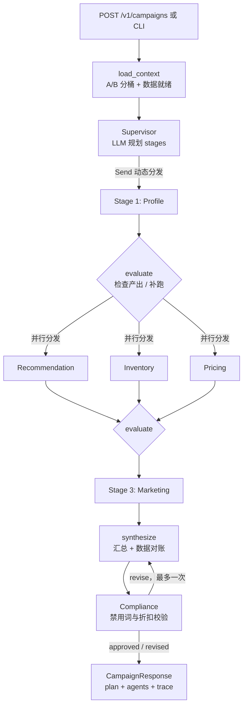

# ecom-multi-agent-lab

基于 **LangGraph** 的电商营销决策多智能体实验台：输入一次营销请求，Supervisor 动态编排 5 个专家 Agent 并行协作，产出一份经过库存校验、定价约束与广告法合规审查的完整投放方案。

- 无 API Key 也能跑通全流程（内置确定性规则引擎作为 mock LLM 与降级路径）
- 配置任意 OpenAI 兼容端点后，同一套图、同一套状态契约切换为真实 LLM
- 内置 A/B 分流、结构化追踪、Prometheus 风格指标、防幻觉对账、有限次重写循环
- 附带 FastAPI、CLI、SQLite 种子数据、单元测试、Docker 与 GitHub Actions

## 与参考项目的关系

架构灵感来自 GitHub 开源项目 [bcefghj/multi-agent-ecommerce-system](https://github.com/bcefghj/multi-agent-ecommerce-system)（Supervisor 编排 + 用户画像／商品推荐／库存／营销文案四个专家 Agent，并提供 Python/Java/Go 三语言实现）。

本项目**只借鉴其「Supervisor + 专家 Agent」的分层思想**，全部代码、提示词、数据模型与数据均为独立编写，未复制参考项目的任何源代码。在此之上做了这些扩展：

| 维度 | 参考项目 | 本项目 |
| --- | --- | --- |
| 编排 | 固定流水线 / 图 | Supervisor 运行时决定阶段，用 `Send` 动态并行分发，支持缺失结果补跑 |
| 专家 | 4 个 | 6 个：新增定价、合规审查 |
| 状态 | 各语言各自实现 | 单一 LangGraph `TypedDict` 状态 + reducer，跨语言无关 |
| LLM | 需外部配置 | 真实 LLM 与离线规则引擎双模式，调用失败自动降级 |
| 实验 | A/B 测试服务 | 稳定哈希分桶直接驱动 Supervisor 的 Agent 编排差异 |
| 可信度 | 无 | 汇总节点强制用工具数据对账 SKU / 折扣 / 券，防止模型编造 |
| 观测 | 无 | 每次运行生成 span、事件、token 与降级报告，`/metrics` 暴露计数器 |
| 交付 | 源码 | FastAPI + CLI + Docker + CI + 32 个测试 |

> 合规说明：参考仓库未声明开源许可证，因此本项目仅参考其公开的架构描述与目录组织方式，代码实现完全独立，并以 MIT 许可证发布。

## 架构



同一阶段内的 Agent 互不依赖，由 `Send` 在同一超步并行执行；阶段之间串行，后一阶段能读取前一阶段的产出。合规 Agent 不参与 Supervisor 路由，任何方案都必须过审。

## 快速开始

```bash
git clone <your-repo-url> ecom-multi-agent-lab
cd ecom-multi-agent-lab
python -m venv .venv
source .venv/bin/activate        # Windows: .venv\Scripts\activate
pip install -r requirements.txt

# 零配置跑一次（自动创建并填充 SQLite）
python cli.py run --user U1001 --scene "618大促" --budget 500
```

输出示例：

```
trace_id   : 2262b005a27744a3
variant    : A   mode: mock
segment    : 高价值
headline   : 618大促｜一份给你的挑选清单
SKUs       : SKU-1001, SKU-1003, SKU-1009
discount   : 0%   coupon: 无
compliance : approved []
agents:
  - profile         分层=高价值，偏好=数码,运动
  - recommendation  推荐 3 个 SKU，排除缺货 1 个
  - inventory       可售 11 个，风险 3 个
  - marketing       ...
  - compliance      合规裁决=approved
```

`A` 组关闭定价 Agent，因此没有折扣；换一个落在 `B` 组的用户即可看到定价与转化型文案。用 `python cli.py variant --user U1001` 查看任意用户的分桶。

启动服务：

```bash
python cli.py serve                       # 或 make serve
curl -s -X POST http://127.0.0.1:8000/v1/campaigns \
  -H 'Content-Type: application/json' \
  -d '{"user_id":"U1001","scene":"618大促","budget":500}' | jq
```

打开 `http://127.0.0.1:8000/docs` 查看交互式 API 文档。

## 接入真实 LLM

```bash
cp .env.example .env
# 编辑 .env：LLM_PROVIDER=openai、LLM_API_KEY、LLM_BASE_URL、LLM_MODEL
python cli.py run --user U1001 --scene "沉睡召回" --budget 300
```

任何 OpenAI Chat Completions 兼容服务都可用（OpenAI、DeepSeek、通义千问、vLLM、Ollama 网关等）。客户端会：

1. 要求 JSON 输出并解析，失败自动重试；
2. 遇到不支持 `response_format` 的网关时自动降级重试；
3. 对相同 prompt 做进程内缓存；
4. 连续失败或返回脏数据时，Agent 自动回退到规则引擎，并在 `AgentResult.degraded` 与追踪报告里标记。

因此线上 LLM 抖动不会让整条链路 500，只是当次决策退化为保守规则结果。

## HTTP 接口

| 方法 | 路径 | 说明 |
| --- | --- | --- |
| GET | `/healthz` | 健康检查与当前运行模式 |
| POST | `/v1/campaigns` | 运行一次营销决策 |
| GET | `/v1/traces/{trace_id}` | 查看该次运行的 span、事件与降级记录 |
| GET | `/v1/experiments/assign?user_id=...` | 查询 A/B 分桶 |
| GET | `/v1/catalog/users` | 示例用户列表 |
| GET | `/metrics` | Prometheus 文本格式计数器 |

请求体字段：`user_id`（必填）、`scene`、`goal`、`channel`、`budget`、`top_n`、`experiment_key`、`dry_run`。

## 设计要点

- **Supervisor 不是硬编码 if/else**：由 LLM 产出分阶段计划，`normalize()` 会过滤未知节点、保证 profile 先行、marketing 收尾、移除被实验关闭的 Agent，避免不可信模型把图带进死循环。
- **失败可见、不静默**：每个 Agent 统一返回 `AgentResult`，包含工具调用、耗时、token、降级标记与错误原因。
- **防幻觉对账**：`reconcile_plan()` 允许 LLM 写文案，但 SKU、折扣、优惠券、库存结论一律以工具与专家结果覆盖。
- **有界重写**：合规审查给出 `revise` 时最多回到 `synthesize` 一次，避免无限循环。
- **人工审批**：`REQUIRE_APPROVAL=true` 会在合规节点前中断（基于 LangGraph checkpointer），CLI 演示模式自动放行，生产可接入人工确认后 `invoke(None)` 继续。
- **确定性 A/B**：`sha256(experiment_key:user_id)` 分桶，无需共享存储，同一用户永远落在同一组。

## 目录结构

```
src/ecom_agents/
├── config.py            环境配置与默认阶段
├── schemas.py           Pydantic 契约
├── experiments.py       A/B 分桶与变体配置
├── observability.py     结构化日志 / span / 指标
├── runner.py            一次运行的编排入口
├── app.py / cli.py      FastAPI / 命令行
├── agents/              BaseAgent + 6 个专家 Agent
├── llm/                 客户端、提示词、离线规则引擎
├── graph/               状态、Supervisor、节点、构图
└── tools/               SQLite 数据层与 Agent 工具面
tests/                   单元 / 图 / API 测试
data/seed.json           4 个用户、12 个商品、订单与优惠券
docs/architecture.md     更完整的设计说明
```

## 测试与部署

```bash
make test                 # 32 个测试，全程 mock 模式，无需网络
docker compose up --build # http://127.0.0.1:8000
```

`.github/workflows/ci.yml` 在 Python 3.11 / 3.12 / 3.13 上跑测试并做一次离线 CLI 冒烟验证。

## 配置

所有配置都通过环境变量或 `.env` 读取，完整清单见 `.env.example`。常用项：`LLM_PROVIDER`、`LLM_API_KEY`、`LLM_BASE_URL`、`LLM_MODEL`、`AB_ENABLED`、`AB_SPLIT`、`REQUIRE_APPROVAL`、`MAX_AGENT_RETRIES`、`ECOM_DB_PATH`。

## 后续可以做的

接入真实商品与订单服务替换 SQLite、把内存 checkpointer 换成 Postgres、把 `/metrics` 换成 OpenTelemetry exporter、把合规词表换成规则引擎服务、增加多轮对话与长期记忆。

## License

MIT。架构灵感致谢 [bcefghj/multi-agent-ecommerce-system](https://github.com/bcefghj/multi-agent-ecommerce-system)；本项目代码独立实现。
